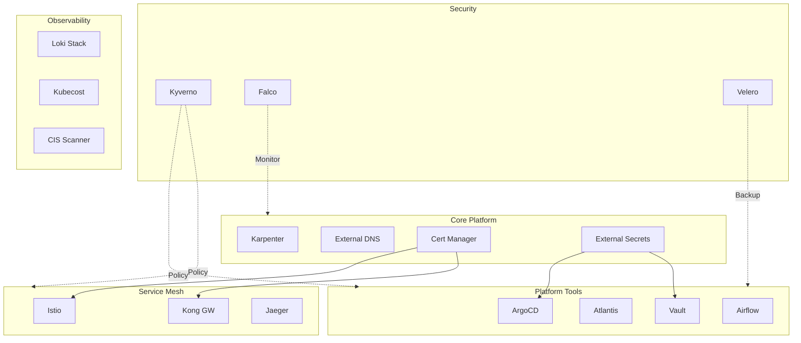

<p align="center">
  
  
  
  
</p>

# Kubernetes Platform Terraform Modules

Reusable Terraform modules for deploying and managing a production-ready Kubernetes platform on AWS EKS. Used by [kubelaunch-essentials](https://github.com/cloudon-one/kubelaunch-essentials) as the module source for all platform components.

---

## Table of Contents

- [Module Matrix](#module-matrix)
- [Architecture](#architecture)
- [Quick Start](#quick-start)
- [Module Structure](#module-structure)
- [Prerequisites](#prerequisites)
- [Contributing](#contributing)

---

## Module Matrix

| Layer | Module | Purpose | Chart Version |
|-------|--------|---------|---------------|
| **Core Platform** | [karpenter](./k8s-platform-karpenter) | Node auto-provisioning | v1.10.0 |
| | [external-dns](./k8s-platform-external-dns) | Route53 DNS automation | - |
| | [cert-manager](./k8s-platform-cert-manager) | Certificate lifecycle (ACME/Let's Encrypt) | - |
| | [external-secrets](./k8s-platform-external-secrets) | AWS Secrets Manager sync | v2.2.0 |
| **Service Mesh** | [istio](./k8s-platform-istio) | Service mesh with mTLS | - |
| | [kong-gw](./k8s-platform-kong-gw) | API gateway with RDS backend | - |
| | [jaeger](./k8s-platform-jaeger) | Distributed tracing (OTEL) | - |
| **Security** | [kyverno](./k8s-platform-kyverno) | Admission control & policies | v3.7.1 |
| | [falco](./k8s-platform-falco) | Runtime threat detection (eBPF) | v8.0.1 |
| | [velero](./k8s-platform-velero) | Backup & disaster recovery | v12.0.0 |
| **Observability** | [loki-stack](./k8s-platform-loki-stack) | Log aggregation (S3 backend) | - |
| | [kubecost](./k8s-platform-kubecost) | FinOps / cost monitoring | - |
| | [compliance-scanner](./k8s-platform-compliance-scanner) | CIS benchmark scanning | v1.2.0 |
| **Platform Tools** | [argocd](./k8s-platform-argocd) | GitOps deployment | - |
| | [atlantis](./k8s-platform-atlantis) | Terraform PR automation | v5.1.0 |
| | [vault](./k8s-platform-vault) | Secrets management (HA + KMS) | - |
| | [airflow](./k8s-platform-airflow) | Workflow orchestration | - |

---

## Architecture



**Deployment order**: Core Platform -> Service Mesh -> Security -> Observability -> Platform Tools

---

## Quick Start

```hcl
# Example: Deploy ArgoCD via Terragrunt
module "argocd" {
  source = "git::https://github.com/cloudon-one/k8s-platform-modules.git//k8s-platform-argocd?ref=main"

  environment      = "dev"
  eks_cluster_name = "dev-eks-cluster"
}
```

Each module supports IRSA (IAM Roles for Service Accounts) for secure AWS access without hardcoded credentials.

---

## Module Structure

```
k8s-platform-<component>/
├── main.tf            # Resources (Helm releases, IAM, K8s objects)
├── variables.tf       # Input variables
├── outputs.tf         # Output values
├── versions.tf        # Provider constraints (aws ~>6.0, k8s ~>3.0, helm ~>3.1)
├── data.tf            # Data sources (optional)
├── templates/         # Helm values templates (optional)
│   └── values.yaml
└── examples/          # Example usage (optional)
    └── main.tf
```

---

## Prerequisites

| Requirement | Version |
|------------|---------|
| Terraform | >= 1.12.0 |
| AWS Provider | ~> 6.0 |
| Kubernetes Provider | ~> 3.0 |
| Helm Provider | ~> 3.1 |
| EKS Cluster | With IRSA enabled |
| Helm | v3.x |

---

## Security

- **IRSA**: All modules use IAM Roles for Service Accounts (no hardcoded credentials)
- **Least privilege IAM**: Specific permissions instead of wildcards
- **Pod security**: Non-root containers, dropped capabilities, read-only filesystems
- **Encryption**: Data at rest and in transit across all components
- **Network isolation**: Security groups and network policies

---

## Contributing

1. Fork the repository
2. Create feature branch
3. Follow existing module patterns (versions.tf, variables.tf, outputs.tf)
4. Add outputs for all created resources
5. Open a Pull Request

---

## License

MIT License - see [LICENSE](LICENSE) for details.
